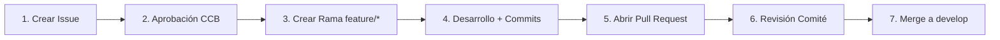

# Guía de Contribución (CONTRIBUTING)

Bienvenido a la guía oficial de contribución para el proyecto **Boletería Front**. Este documento establece las normas obligatorias de desarrollo, flujo de trabajo, convenciones de ramas y commits, y el proceso de gestión de cambios.

---

## 1. Flujo de Trabajo: GitFlow Adaptado

Siguiendo las directrices de la asignatura y los lineamientos de control de versiones (Unidad 2.2 - Git), el proyecto adopta el flujo de trabajo **GitFlow**.

```
[main] ---------------------------------(Merge Release / Hotfix)--- v1.0.0
         \                             /
[release] \---------------------[release/v0.1.0]------------------
           \                   /
[develop] --\-----------------(Merge Feature)--------------------
             \               /
[feature]     \--[feature/issue-XX-nombre]--
```

### Estructura y Rol de las Ramas

1. **`main` (o master):**
   * Contiene el código en estado de producción y versiones desplegables y estables.
   * Nunca se realizan commits directos sobre `main`.
   * Solo recibe fusiones provenientes de ramas `release/*` o `hotfix/*`.

2. **`develop`:**
   * Rama central de integración continua.
   * Contiene el desarrollo activo del parcial.
   * Se crea a partir de `main` y es la base de donde parten todas las ramas `feature/*`.

3. **`feature/<nombre>` (o `feature/issue-<num>-<descripcion>`):**
   * Se crean exclusivamente a partir de `develop`.
   * Alojan el desarrollo de nuevas funcionalidades o módulos.
   * Al completarse, se integran de vuelta en `develop` mediante un **Pull Request**.

4. **`release/<version>`:**
   * Se crean a partir de `develop` cuando se alcanza un hito de entrega o fin de parcial.
   * Se utilizan para pruebas finales, ajustes menores y documentación.
   * Se fusionan tanto en `main` (con su respectivo Tag de SemVer) como en `develop`.

5. **`hotfix/<nombre>`:**
   * Se crean directamente a partir de `main` ante fallos críticos en producción.
   * Una vez solucionado el problema, se fusionan en `main` y en `develop`.

> [!IMPORTANT]
> **REGLA DE ORO DE LA CÁTEDRA: NO BORRAR RAMAS**
> Ninguna rama (`feature/*`, `release/*`, `hotfix/*`) debe ser eliminada tras completar su fusión. Se deben conservar íntegras en el repositorio remoto como evidencia y trazabilidad del trabajo del equipo y para fines de auditoría de configuración.

---

## 2. Convención de Commits: Conventional Commits

Todos los mensajes de confirmación deben seguir rigurosamente el estándar **Conventional Commits**:

```text
<tipo>(<alcance>): <descripción corta en imperativo>

[cuerpo opcional detallado]

[pie opcional con referencias a issues]
```

### Tipos Permitidos:
* **`feat`**: Nueva funcionalidad para el usuario.
* **`fix`**: Corrección de un error o bug.
* **`docs`**: Modificaciones exclusivamente en documentación.
* **`style`**: Ajustes de formato, espaciado o linting que no alteran la lógica del código.
* **`refactor`**: Refactorización de código que no corrige errores ni añade nuevas funcionalidades.
* **`perf`**: Cambios orientados a optimizar el rendimiento.
* **`test`**: Creación o actualización de pruebas unitarias o de integración.
* **`chore`**: Actualizaciones de configuración, dependencias o tareas de compilación/herramientas.

### Reglas para los Mensajes:
1. Escribir en tiempo imperativo y minúsculas: `feat(auth): add login view` (no `added` ni `adding`).
2. Sin punto al final del título.
3. Máximo 72 caracteres en la primera línea.
4. **Queda prohibido** añadir etiquetas de autoría generada por IA ("Co-Authored-By", etc.).

---

## 3. Comité de Control de Cambios (CCB) y Ciclo de Vida de Tareas

Ningún código se escribe ni se integra sin pasar por el proceso formal de control de cambios:



### Procedimiento:
1. **Creación del Issue:** Se registra el ticket en GitHub Issues describiendo el requerimiento o defecto, impacto y componentes afectados.
2. **Aprobación del Comité:** El Comité de Control de Cambios evalúa la solicitud. Si es aprobada, se asigna al integrante responsable y se marca con la etiqueta correspondiente (`aprobado-ccb`, `sprint-1`, etc.).
3. **Creación de Rama:** El desarrollador crea su rama desde `develop`:
   ```bash
   git checkout develop
   git pull origin develop
   git checkout -b feature/issue-12-seleccion-asientos
   ```
4. **Desarrollo y Commits:** Se realizan commits atómicos siguiendo Conventional Commits.
5. **Creación del Pull Request:** Se abre el PR apuntando a `develop`.
6. **Cierre Automático de Issues:** La descripción del Pull Request DEBE incluir la palabra clave de cierre oficial de GitHub:
   * `Closes #12`
   * `Fixes #12`
   * `Resolves #12`
7. **Revisión y Merge:** Al menos un integrante revisor del comité aprueba el PR. Se realiza el merge conservando el historial. **La rama no se elimina.**

---

## 4. Versionamiento Semántico (SemVer)

Las versiones oficiales del proyecto siguen el estándar SemVer (`MAJOR.MINOR.PATCH`):
* Se marcan mediante **Tags anotados** en Git:
  ```bash
  git tag -a v0.1.0 -m "Release inicial base v0.1.0"
  git push origin v0.1.0
  ```

---

## 5. Código de Conducta

Esperamos que todos los integrantes mantengan un ambiente de respeto, colaboración y profesionalismo. Toda revisión de código debe ser constructiva y enfocada en el aspecto técnico, nunca dirigida a la persona.

---

## 6. Requisitos Previos y Configuración Local

Antes de comenzar a programar, asegúrate de:
1. Tener instalado **Node.js >= 20.x** y **npm >= 10.x**.
2. Contar con acceso al repositorio en GitHub y permisos de escritura.
3. Clonar el repositorio e instalar las dependencias:
   ```bash
   npm install
   cp .env.example .env
   ```
4. Completar las variables de entorno de `.env` (credenciales de Supabase, etc.) según las instrucciones del [README.md](README.md).

---

## 7. Política de Revisión y Pruebas

* **Pruebas locales:** Antes de abrir el Pull Request, verifica que la aplicación compile y corra sin errores en consola, y que las pruebas pasen:
  ```bash
  npm run build
  npm run test
  ```
* **Revisión de código:** Todo Pull Request debe ser aprobado por al menos un integrante revisor del comité antes de fusionarse en `develop`.
* **Commits pequeños y atómicos:** Cada commit debe representar un único cambio lógico para facilitar la revisión.

---

## 8. Reconocimiento

Toda contribución aprobada y fusionada en `develop` forma parte vital del éxito del proyecto. ¡Gracias por hacer crecer este sistema de boletería!
